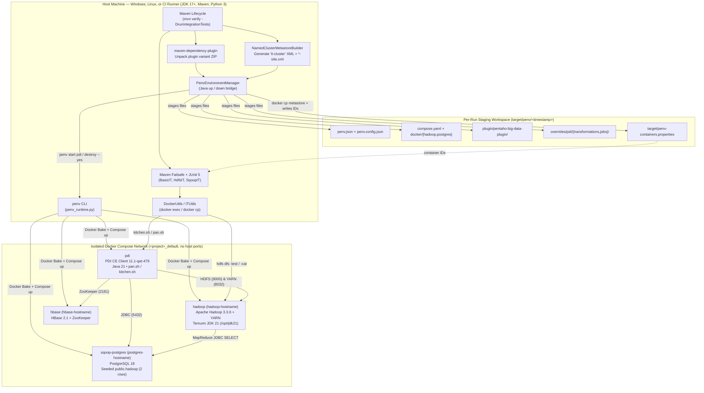
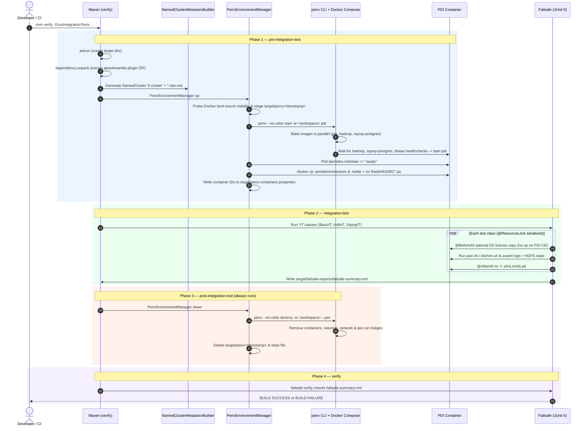
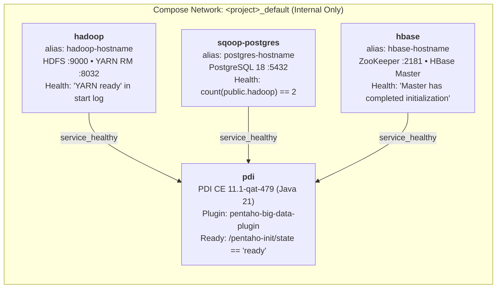
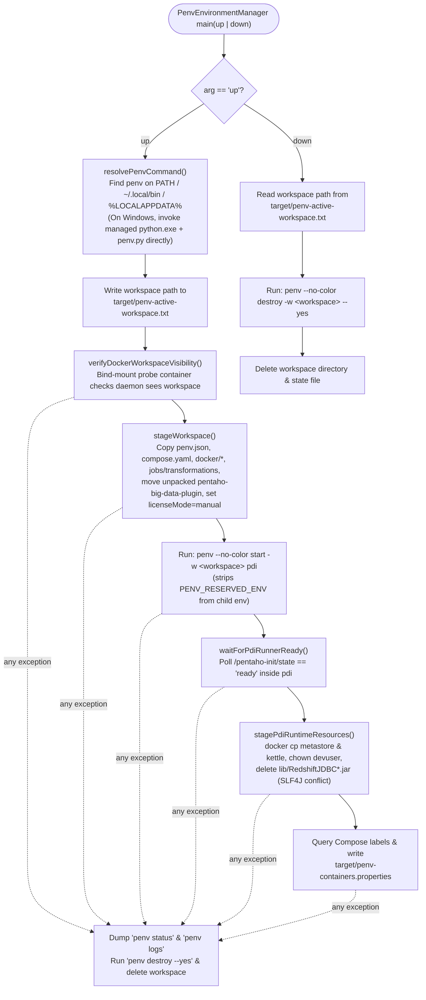
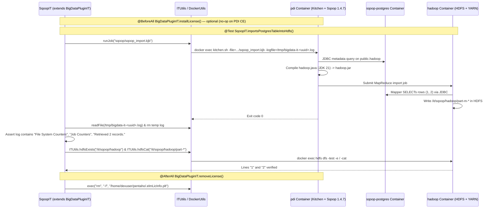
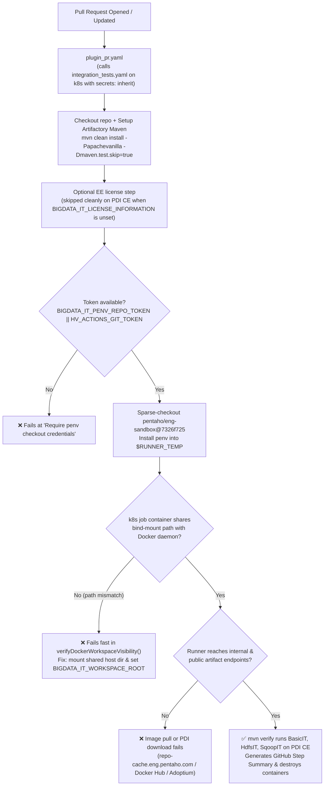

# Maven + `penv` Integration Test Architecture

This document explains how the Big Data plugin integration-test framework works end to end across
Windows, Linux, and GitHub Actions using **Maven** as the cross-platform entry point and **`penv`**
as the container environment provisioner.

For quick-start commands see [plugin-integration-test-readme.md](plugin-integration-test-readme.md).
For the deep dive into Java 21 bytecode compatibility between PDI, Sqoop, and YARN see
[sqoop-hadoop-java-versions.md](sqoop-hadoop-java-versions.md).

## Contents

- [1. Architectural overview](#1-architectural-overview)
- [2. End-to-end Maven lifecycle](#2-end-to-end-maven-lifecycle)
- [3. Container and network topology](#3-container-and-network-topology)
- [4. Key components and code walkthrough](#4-key-components-and-code-walkthrough)
  - [4.1 Declarative environment manifests (`penv.json`, `compose.yaml`, Dockerfiles)](#41-declarative-environment-manifests-penvjson-composeyaml-dockerfiles)
  - [4.2 `PenvEnvironmentManager` — cross-platform lifecycle bridge](#42-penvenvironmentmanager--cross-platform-lifecycle-bridge)
  - [4.3 `NamedClusterMetastoreBuilder` — client cluster configuration](#43-namedclustermetastorebuilder--client-cluster-configuration)
  - [4.4 `BigDataPluginIT`, `SqoopIT`, `ITUtils`, and `DockerUtils`](#44-bigdatapluginit-sqoopit-itutils-and-dockerutils)
- [5. GitHub Actions PR execution and current blockers](#5-github-actions-pr-execution-and-current-blockers)

---

## 1. Architectural overview

Running `mvn verify -DrunIntegrationTests` on **Windows** or **Linux** executes the entire test
lifecycle in Java and Python without any host-side `.sh` or `.bat` wrapper scripts:

1. **Maven** unpacks the built `pentaho-big-data-plugin` ZIP and generates the Named Cluster XML
   metastore on the host.
2. **`PenvEnvironmentManager`** stages an isolated per-build workspace (`target/penv/<timestamp>`)
   and delegates image building, healthcheck orchestration, and teardown to **`penv`**.
3. **`penv` + Docker Compose** build a clean PDI CE 11.1 client image (with the built Big Data
   plugin replacing the stock one; no EE license required) alongside derived Hadoop/YARN, seeded
   PostgreSQL, and HBase containers on an isolated internal network.
4. **JUnit 5 (Maven Failsafe)** runs Kettle jobs (`kitchen.sh`) and transformations (`pan.sh`)
   inside the PDI container via `DockerUtils` and asserts results against logs, HDFS, and HBase.

### Why this replaces `docker-maven-plugin` cleanly

| Aspect | Previous (`docker-maven-plugin`) | Current (`Maven + penv`) |
| --- | --- | --- |
| **PDI base artifact** | Required pre-built `automation/pdi-client:11.1` Docker image | Builds directly from pinned QAT/release archive (`11.1-qat-479`) cached in `$PENV_HOME/cache` |
| **Plugin installation** | Overlaid files onto existing plugin folder, risking leftover JARs | `penv` deletes `plugins/pentaho-big-data-plugin` first, then copies the exact built plugin |
| **Image tag isolation** | Shared static tags (`bigdata-it-hadoop:11.1`), unsafe for concurrent runs | Scoped to `${REPRO_PROJECT_NAME}/hadoop:it` & `sqoop-postgres:it`, built in parallel via Docker Bake and removed by `penv destroy` |
| **Host OS support** | Needed OS-specific Docker socket/pipe Maven profiles | Uses standard `docker` / `docker compose` CLI from Java on Windows, macOS, and Linux |
| **Local debugging** | Tied to Maven plugin internals | Standard `penv status`, `penv logs`, and `penv shell pdi` work directly against `target/penv/<timestamp>` |

---

## 2. End-to-end Maven lifecycle

In Maven, `integration-test` **never aborts the lifecycle on test failure** — Maven always runs
`post-integration-test` before `maven-failsafe-plugin:verify` fails the build. Binding `up` to
`pre-integration-test` and `down` to `post-integration-test` guarantees container cleanup whether
tests pass or fail.

---

## 3. Container and network topology

`penv` generates a base Compose file for `pdi`, and
[`penv/compose.yaml`](pentaho-platform/penv/compose.yaml) layers the Big Data fixtures on top:

- **`ports: !reset []`** strips `penv`'s default host debug port mapping on `pdi`, so **zero ports**
  are published to the host machine (preventing port collisions across parallel builds).
- **`depends_on: !override`** replaces `penv`'s default `repository-db` dependency (which is only
  needed for Pentaho Server, not PDI client) with healthcheck gates on `hadoop`, `sqoop-postgres`,
  and `hbase`.

| Service | Source / Dockerfile | Java Runtime | Key Role in Tests |
| --- | --- | --- | --- |
| **`pdi`** | Built by `penv` from `pdi-ce-11.1.0.0-479.zip` + `./plugin/pentaho-big-data-plugin` | Eclipse Temurin 21 | Executes `pan.sh` (`BasicIT`, `HdfsIT`) and `kitchen.sh` (`SqoopIT`) |
| **`hadoop`** | [`docker/hadoop/Dockerfile`](pentaho-platform/docker/hadoop/Dockerfile) (`FROM apache/hadoop:3.3.6`) | Temurin 21 at `/opt/jdk21` + `--add-opens` | Single-node HDFS NameNode/DataNode + YARN ResourceManager/NodeManager |
| **`sqoop-postgres`** | [`docker/postgres/Dockerfile`](pentaho-platform/docker/postgres/Dockerfile) (`FROM postgres:18`) | N/A | Runs [`01-create-hadoop.sql`](pentaho-platform/docker/postgres/init/01-create-hadoop.sql) to create `public.hadoop` with values `1`, `2` |
| **`hbase`** | `harisekhon/hbase:2.1` | Image default | Standalone HBase + ZooKeeper quorum (`hbase-hostname:2181`) |

---

## 4. Key components and code walkthrough

### 4.1 Declarative environment manifests (`penv.json`, `compose.yaml`, Dockerfiles)

- **[`penv/penv.json`](pentaho-platform/penv/penv.json)**:
  - Pins `"line": "11.1"`, `"stream": "qat"`, `"build": 479`, `"edition": "ce"`, and PDI `"java": 21`
    (using `BigDataCEServiceInitializer` so no EE license is needed).
  - Declares `"plugins": ["./plugin/pentaho-big-data-plugin"]`. During image build, `penv` deletes
    `/out/data-integration/plugins/pentaho-big-data-plugin` from the base PDI distribution before
    copying `./plugin/pentaho-big-data-plugin`, guaranteeing that only the current branch's JARs
    and shim configurations exist in the container.
- **[`penv/compose.yaml`](pentaho-platform/penv/compose.yaml)**:
  - Tags derived fixture images as `${REPRO_PROJECT_NAME:?Set by penv}/hadoop:it` and
    `${REPRO_PROJECT_NAME:?Set by penv}/sqoop-postgres:it`. Because `penv` sets `REPRO_PROJECT_NAME`
    uniquely per workspace (`penv-<timestamp>-<hash>`), `penv start pdi` builds `pdi`, `hadoop`,
    and `sqoop-postgres` concurrently via Docker Bake, and `penv destroy --yes` removes those built
    images automatically during teardown.
- **[`docker/hadoop/Dockerfile`](pentaho-platform/docker/hadoop/Dockerfile) &
  [`docker/postgres/Dockerfile`](pentaho-platform/docker/postgres/Dockerfile)**:
  - Bake XML configs, init scripts, CRLF normalization (`sed -i 's/\r$//'`), and Temurin JDK 21
    (`/opt/jdk21`) directly into image layers rather than relying on `docker-maven-plugin`'s
    proprietary XML assembly DSL.

### 4.2 `PenvEnvironmentManager` — cross-platform lifecycle bridge

[`PenvEnvironmentManager.java`](pentaho-platform/src/test/java/org/pentaho/big/data/it/PenvEnvironmentManager.java)
is invoked by `exec-maven-plugin` in `pre-integration-test` (`up`) and `post-integration-test`
(`down`).

Important implementation details inside `PenvEnvironmentManager`:

- **Direct Python invocation on Windows (`resolvePenvCommand`)**: When `penv.cmd` is found on
  Windows, `PenvEnvironmentManager` resolves `<installDir>\.venv\Scripts\python.exe` + `penv.py`
  directly instead of wrapping `cmd.exe /c penv.cmd`, avoiding batch argument-splitting quirks.
- **Environment sanitization (`PENV_RESERVED_ENV`)**: `penv` intentionally aborts if internal
  Compose variables (`COMPOSE_PROJECT_NAME`, `REPRO_PROJECT_NAME`, `DOCKER_PLATFORM`, etc.) are
  inherited from a parent shell. `PenvEnvironmentManager` strips those keys from the child
  `ProcessBuilder` environment.
- **PDI readiness synchronization (`waitForPdiRunnerReady`)**: `penv`'s headless PDI container runs
  `penv_runner.py`, which initializes `/home/devuser` and writes `"ready"` to `/pentaho-init/state`.
  Waiting for `"ready"` ensures `docker cp` into `~/.pentaho/metastore` cannot race container init.
- **Redshift JDBC removal**: Deletes `data-integration/lib/RedshiftJDBC*.jar` in the PDI container
  because its shaded SLF4J 1.7 classes collide with the Big Data shim's SLF4J 2.x binding.

### 4.3 `NamedClusterMetastoreBuilder` — client cluster configuration

[`NamedClusterMetastoreBuilder.java`](pentaho-platform/src/test/java/org/pentaho/big/data/it/NamedClusterMetastoreBuilder.java)
runs during `pre-integration-test` before `PenvEnvironmentManager up`. It initializes Kettle's
`XmlMetaStore` on the host and creates the `it-cluster` Named Cluster (`shimIdentifier=apachevanilla`)
pointing at the Compose network aliases (`hadoop-hostname:9000`, `hadoop-hostname:8032`,
`hbase-hostname:2181`), along with synchronized client-side `core-site.xml`, `hdfs-site.xml`,
`yarn-site.xml`, `mapred-site.xml` (including `mapreduce.jvm.add-opens-as-default=false` and Java 21
`--add-opens` flags), and `hbase-site.xml`.

### 4.4 `BigDataPluginIT`, `SqoopIT`, `ITUtils`, and `DockerUtils`

Key cross-platform details in the test harness:

- **[`BigDataPluginIT.java`](pentaho-platform/src/test/java/org/pentaho/big/data/it/BigDataPluginIT.java)**:
  Annotated with `@ResourceLock("bigdata-it-pdi-container")` so test classes never race on the
  shared PDI container (or on an optional `/home/devuser/pentaho/.elmLicInfo.plt` license file if
  `-Dbigdata.it.license-file` is explicitly supplied for EE runs).
- **[`ITUtils.java`](pentaho-platform/src/test/java/org/pentaho/big/data/it/ITUtils.java)**:
  Resolves container IDs from `-Dbigdata.it.*-container-id` system properties or falls back to
  `target/penv-containers.properties` generated by `PenvEnvironmentManager`.
- **[`DockerUtils.java`](pentaho-platform/src/test/java/org/pentaho/big/data/it/DockerUtils.java)**:
  - Drains `stdout` and `stderr` concurrently on background threads so verbose Kettle output can
    never deadlock on a full 64 KB OS pipe buffer.
  - Implements `execShell()` by streaming the shell script over `stdin` to
    `docker exec -i <id> /bin/bash -ls`, avoiding Windows `ProcessImpl` / `CommandLineToArgvW`
    bugs with embedded double quotes.

---

## 5. GitHub Actions PR execution and current blockers

### Will this run automatically when a PR is created on GitHub?

**Yes.** Opening or updating a pull request triggers
[`.github/workflows/plugin_pr.yaml`](../.github/workflows/plugin_pr.yaml) whenever code files or the
IT workflow files change (markdown-only PRs are ignored via `!**/*.md`). `plugin_pr.yaml` calls
[`.github/workflows/integration_tests.yaml`](../.github/workflows/integration_tests.yaml) with
`runs_on: k8s`, `plugin_variant: apachevanilla`, and `secrets: inherit`.

> **Note:** Pentaho's Jenkins PR check (`wingman.eng.pentaho.com`) also runs `mvn clean verify` on
> PRs, but because it does **not** pass `-DrunIntegrationTests`, the `bigdata-it-profile` stays
> inactive there and Jenkins continues running unit tests only.

### CI considerations for PR runs in GitHub Actions

| # | Area | Status / Resolution | Notes |
| --- | --- | --- | --- |
| **1** | **PDI license (`BIGDATA_IT_LICENSE_INFORMATION`)** | **Resolved — no secret required.** `penv/penv.json` uses `"edition": "ce"` (`pdi-ce`), and `pentaho-big-data-plugin` bootstraps all Big Data services via `BigDataCEServiceInitializer`. | Because `pentaho/big-data-plugin` is a public repository, never commit `.elmLicInfo.plt`. `BIGDATA_IT_LICENSE_INFORMATION` remains optional if `"edition": "ee"` is ever tested. |
| **2** | **`pentaho/eng-sandbox` checkout token** | **Resolved via org fallback (`secrets.BIGDATA_IT_PENV_REPO_TOKEN \|\| secrets.HV_ACTIONS_GIT_TOKEN`).** `integration_tests.yaml` inherits org secrets via `secrets: inherit`. | Verify `HV_ACTIONS_GIT_TOKEN` has `Contents: Read` access to `pentaho/eng-sandbox` (or set `BIGDATA_IT_PENV_REPO_TOKEN`). |
| **3** | **Docker sibling-container bind-mount path mapping on `k8s` runners** | **Mitigated in `integration_tests.yaml`.** On `pentaho-runner-*` (`k8s` ARC), GitHub Actions starts `PDIA_AC_CONTAINER_IMAGE` with `-v /runner/_work:/__w`, so `/__w/...` does not exist on the Docker daemon's filesystem. `integration_tests.yaml` mounts `/runner/_work/_temp/bigdata-it-workspaces:/runner/_work/_temp/bigdata-it-workspaces` identically into the job container and sets `BIGDATA_IT_WORKSPACE_ROOT` there by default. | Keep that identical-path mount, or override `vars.BIGDATA_IT_WORKSPACE_ROOT` if runner host paths ever change (`verifyDockerWorkspaceVisibility()` fails fast in <2 s if mismatched). |
| **4** | **External fork PRs & runner network reachability** | GitHub Actions withholds `secrets.*` on `pull_request` events from external forks. Also, the runner must resolve internal `repo-cache.eng.pentaho.com` (PDI CE zip), `docker.io`, and `api.adoptium.net`. | Keep `runs_on: k8s` (internal Pentaho network has `repo-cache.eng.pentaho.com` access; public `ubuntu-latest` does not), open PRs from branches in `pentaho/big-data-plugin`, and optionally set `BIGDATA_IT_PENV_HOME` on a persistent runner cache mount. |
